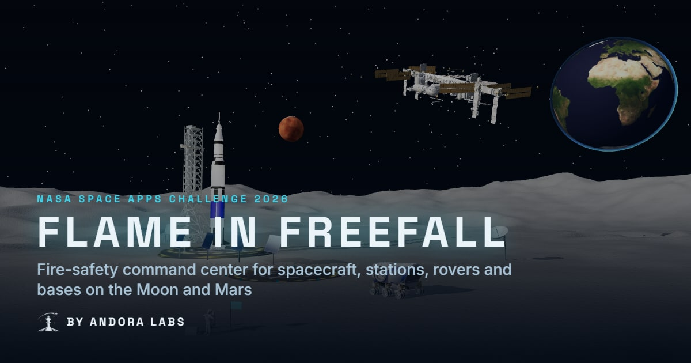
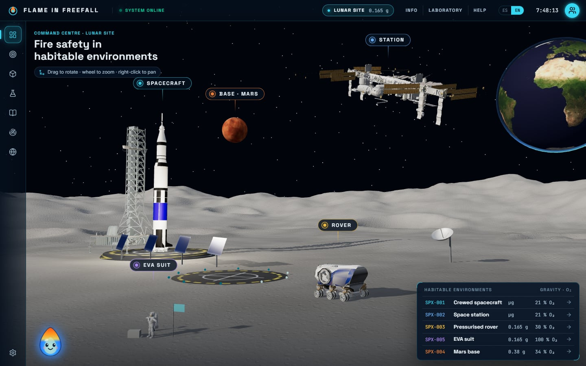
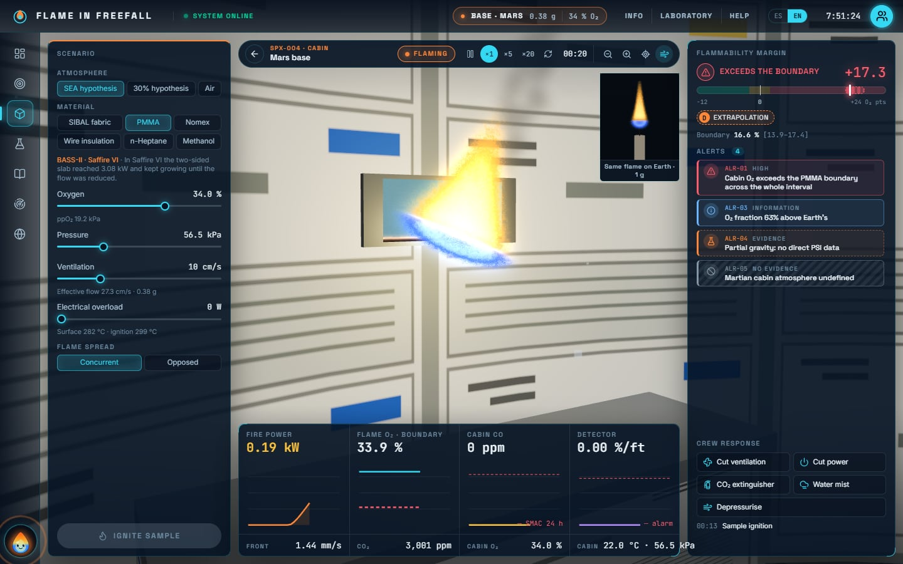
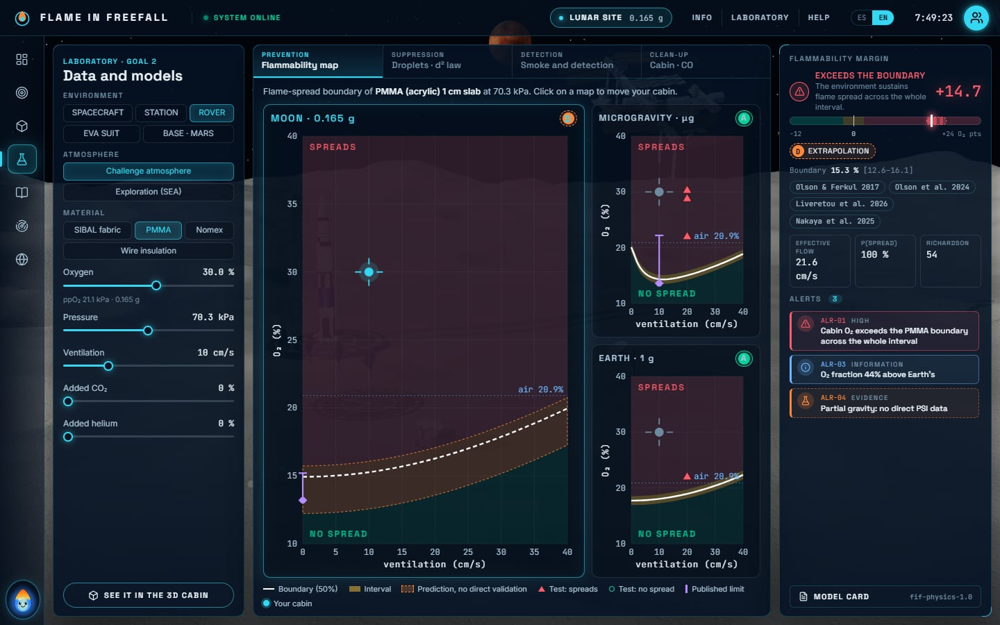
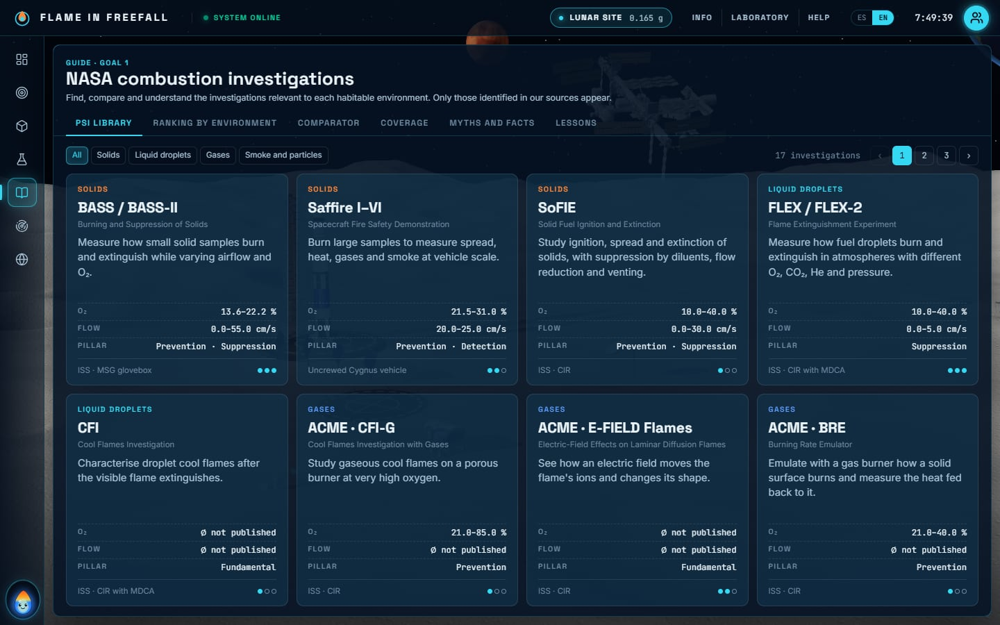
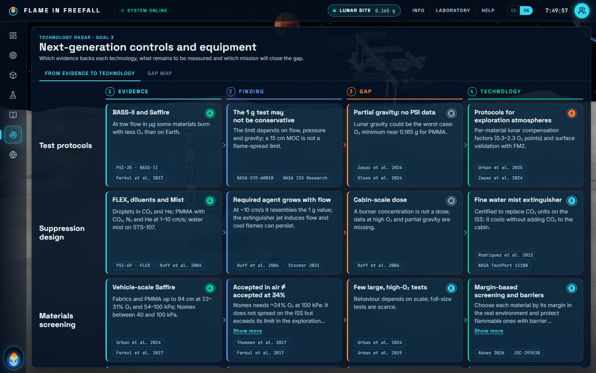
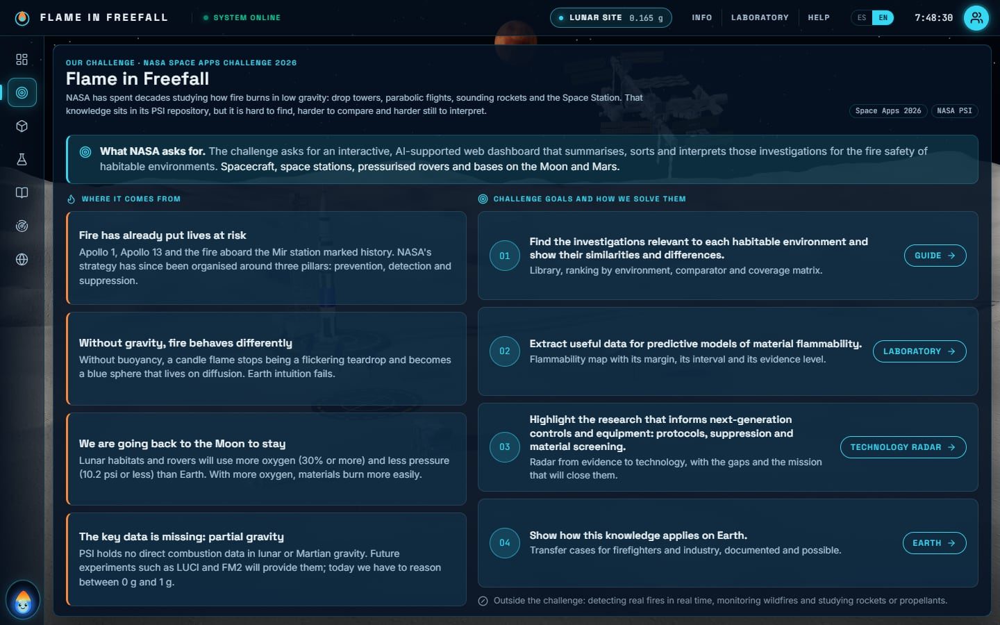
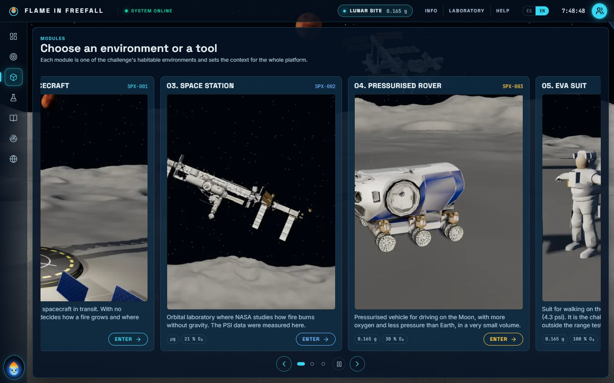

<div align="center">



# Flame in Freefall

### Fire-safety command center for spacecraft, stations, rovers and bases on the Moon and Mars

**NASA Space Apps Challenge 2026 · Challenge: Flame in Freefall · Team Andora Labs · Riobamba, Ecuador**


[The challenge](#-the-challenge) · [Our solution](#-our-solution) · [Tour](#-a-tour-of-the-platform) · [Scientific rigor](#-scientific-rigor) · [Run it](#-run-it-locally) · [Team](#-team-andora-labs)

</div>

---

## 🔥 The challenge

NASA has studied how fire burns in low gravity for decades: drop towers, parabolic flights,
sounding rockets and the International Space Station. The results live in the
[Physical Sciences Informatics (PSI)](https://psi.nasa.gov/) repository, but they are hard to
find, harder to compare and harder still to interpret.

That matters now because we are going back to the Moon to stay:

- **Fire behaves differently without gravity.** With no buoyancy, a candle flame stops being a
  flickering teardrop and becomes a dim blue sphere that lives on diffusion. Earth intuition fails.
- **Exploration atmospheres burn more easily.** Lunar habitats and rovers will run at 30% oxygen
  or more and 10.2 psi or less.
- **The key data is missing.** PSI holds no direct combustion data in lunar or Martian gravity.
  Future experiments such as LUCI and FM2 will provide it.

The [Flame in Freefall challenge](https://www.spaceappschallenge.org/2026/challenges/flame-in-freefall/)
asks for an interactive, AI-supported web dashboard that summarises, sorts and interprets those
investigations for the fire safety of habitable environments:

| | What NASA asks for | Where we solve it |
|---|---|---|
| **O1** | Find the investigations relevant to each habitable environment and show their similarities and differences | **Guide**: library, ranking by environment, comparator, coverage matrix |
| **O2** | Extract useful data for predictive models of material flammability | **Laboratory** and **Cabin**: flammability margin with its interval and evidence level |
| **O3** | Highlight the research that informs next-generation controls: protocols, suppression, material screening | **Technology radar**: evidence → finding → gap → technology |
| **O4** | Show how this knowledge applies on Earth | **Earth**: documented and possible technology transfers |

Out of scope, as the challenge states: detecting real fires in real time, monitoring wildfires and
studying rockets or propellants.

## 🚀 Our solution

**Flame in Freefall is a mission command center on a single screen.** One persistent 3D world
(a lunar site with a crewed spacecraft, the Space Station, a pressurised rover, an EVA suit and a
Mars base) and panels that change with the route. Pick an environment and everything follows it:
the ranking of investigations, the flammability margin, the alerts, the shape of the flame and
the context of the assistant.

<div align="center">

</div>

What makes it different:

- **A flame you can interrogate.** Inside each cabin you change oxygen, pressure, ventilation and
  material, ignite a sample and watch a volumetric flame respond in real time next to the same
  flame on Earth.
- **Numbers are computed, never written.** A reduced-order physical model returns the flammability
  boundary, the margin, its interval and its evidence level. The assistant does not estimate figures.
- **Honest about what is unknown.** Every result carries an evidence badge (A direct, B analogous,
  C proxy, D extrapolation, ∅ no evidence). "No evidence" is never green and never shown as low risk.
- **Every figure has a source.** Each number links to its DOI or NTRS record.
- **Flamey, an assistant that cites.** A flame mascot whose shape follows the gravity of the active
  environment. It answers from approved answers, the physical model, the catalogue and a RAG over
  the NASA bibliography, with dictation and voice. When there is no evidence, it says so.

## 🛰 A tour of the platform

<table>
<tr>
<td width="50%"><br /><b>Cabin</b> · live flame, telemetry, alerts and crew response (O2)</td>
<td width="50%"><br /><b>Laboratory</b> · flammability map, droplets, smoke and cabin CO (O2)</td>
</tr>
<tr>
<td><br /><b>Guide</b> · PSI library, ranking, comparator, coverage and lessons (O1)</td>
<td><br /><b>Technology radar</b> · from evidence to technology and the gap map (O3)</td>
</tr>
<tr>
<td><br /><b>Our challenge</b> · NASA's brief and where each goal is solved</td>
<td><br /><b>Modules</b> · the five environments and the analysis tools</td>
</tr>
</table>

| Environment | Gravity | Atmosphere | Evidence |
|---|---|---|---|
| Crewed spacecraft | µg | 21% O₂ · 101.3 kPa | Direct or analogous |
| Space station (ISS) | µg | 21% O₂ · 101.3 kPa | Direct: PSI data were measured here |
| Pressurised lunar rover | 0.165 g | 30% O₂ · 70.3 kPa | No direct data: partial gravity |
| EVA suit | 0.165 g or µg | 100% O₂ · 29.6 kPa | Outside the tested range |
| Mars base | 0.38 g | 34% O₂ · 56.5 kPa (hypothesis) | No evidence: undefined atmosphere |

## 🔬 Scientific rigor

- **Never invent data.** Values come from the team's master document or from a source with DOI or
  NTRS record. If a value is not there, the platform shows "No evidence".
- **Evidence levels everywhere.** Partial gravity has no direct data in PSI, so the platform says
  so (alert ALR-04) and uses the most conservative boundary.
- **Tested physics.** The reduced-order model is verified with 38 unit tests against published
  values (Saffire, BASS-II, FLEX and others).
- **Grounded assistant.** Answers show their origin (verified answer, computed by the model,
  documents) and their sources. The corpus is 22 NASA and open-access documents plus the challenge
  report and a project document generated from the platform's own verified content.
- **Declared AI use.** The use of AI and the licence of every asset are listed in the platform
  under *Data and references*.

## 🧱 Architecture

```
├── web/      Next.js app: the command center (this is what you see)
│   ├── src/app/         Thin routes and /api Route Handlers
│   ├── src/features/    Feature-first: world (3D), fire (physics engine), scene, laboratory,
│   │                    investigations, radar, earth, challenge, assistant, shell…
│   ├── src/content/     Typed, bilingual (ES/EN) catalogues with their sources
│   └── docs/            Requirements, master document, build guidelines, full documentation
└── api/      FastAPI backend: PSI ingestion and fire-risk rules (optional; the web app falls
              back to its own services when it is not running)
```

| Layer | Technology |
|---|---|
| Framework | Next.js 16 (App Router, Server Components), TypeScript strict |
| Styles | Sass with CSS Modules and design tokens. No Tailwind, Bootstrap or TanStack |
| 3D | three.js in the browser only; NASA 3D Resources models reduced with our own bake script |
| Charts | Hand-built SVG with `d3-scale` and `d3-shape`, drawn at the real size of their panel |
| Validation | Zod at every boundary; one response envelope for all `/api` routes |
| Assistant | Gemini File Search (RAG), Web Speech API dictation, Fish Audio or browser voice |
| Backend | FastAPI (Python) |
| Quality | ESLint, Vitest (physics against the literature), Playwright (demo walkthrough) |

The state of every screen lives in the URL, so an exact scenario can be shared with a link.

## ⚙️ Run it locally

Requirements: Node.js 20 or later and Google Chrome.

```bash
cd web
```

```bash
npm install
```

```bash
npm run dev
```

Open http://localhost:3000. No environment variable is required: without keys the assistant
answers with its approved answers, the physical model and the local knowledge base. To enable the
RAG and the voice, copy `web/.env.example` to `web/.env.local` and fill in the Gemini and Fish
Audio values.

| Command (inside `web/`) | What it does |
|---|---|
| `npm run check` | Lint, typecheck, unit tests and production build |
| `npm run e2e` | Demo walkthrough with Playwright |
| `npm run ingest` | Indexes `conocimiento/` into the Gemini File Search store |
| `npm run knowledge-doc` | Generates the project document for the assistant corpus |
| `npm run media` | Regenerates the share preview and the screenshots in this README |

Full documentation (in Spanish): [web/docs/documentacion-proyecto.md](web/docs/documentacion-proyecto.md).
Backend: [api/README.md](api/README.md).

## 👥 Team Andora Labs

| | Name | Role |
|---|---|---|
| 👑 | [Juan Stalin Quezada Ruiz](https://www.linkedin.com/in/juansquezada/) | Captain · Project Manager · AI Engineer |
| 🏗 | [Jordy Ricardo Carrión Chávez](https://www.linkedin.com/in/jordy-ricardo25/) | Full-Stack Developer · Software Architect |
| 🎨 | [Zuleyka Naomi Ortiz Salazar](https://www.linkedin.com/in/zuleyka-ortiz-25147237a/) | Creative Director · Designer |
| 📊 | [Lisbeth Aracelly Escudero Coba](https://www.linkedin.com/in/aracelly-escudero-0761023aa/) | Statistics Engineer · Data Analyst |
| ⚙️ | [Johnatan Moises Ley Guacho](https://www.linkedin.com/in/johnatan-guacho-7376563b0/) | Information Technology Engineer · DevOps Manager |
| ⚛️ | [Wagner Nolasco Ramírez Klínger](https://www.linkedin.com/in/nolasco-ram%C3%ADrez-560891280/) | Physics Expert · Combustion Science Lead |

## 📄 Credits and licence

Independent project for the NASA Space Apps Challenge. It uses open NASA data and models; no NASA
endorsement is implied. 3D models come from
[NASA 3D Resources](https://github.com/nasa/NASA-3D-Resources). Code under the MIT licence;
third-party notices in [web/NOTICE](web/NOTICE).

<div align="center">
<sub>Built by <b>Andora Labs</b> for the NASA Space Apps Challenge 2026.</sub>
</div>
